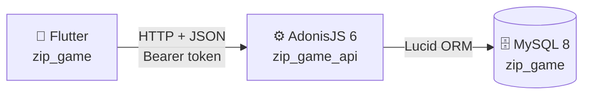
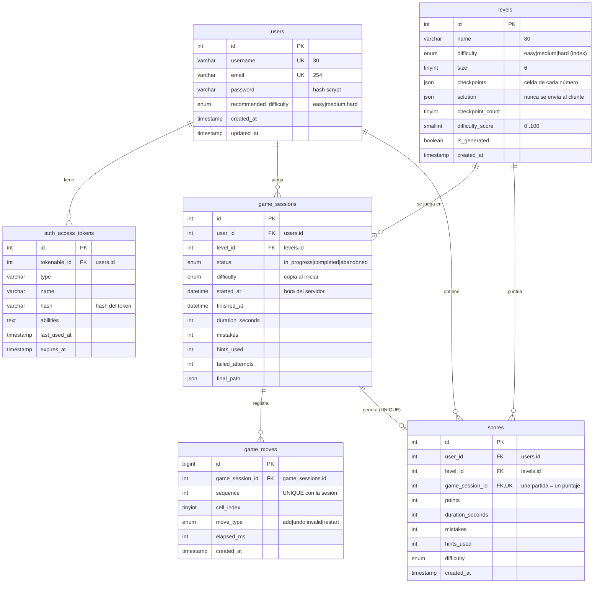
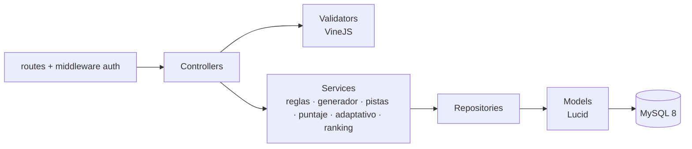

#  ZIP Game
# | Jonathan Rios | Axel Sandoval | Edmundo Cardoza | Miguel Ramirez |

Juego de lógica **ZIP** para dispositivos móviles y web. Práctica I de *Desarrollo para Dispositivos Inteligentes*, UTD, grupo 10°A BIS.

| Parte | Tecnología | Carpeta |
|---|---|---|
| 📱 Frontend | Flutter 3.50 · Dart 3.14 · `material_ui` | [`zip_game/`](zip_game/) |
| ⚙️ Backend (API REST) | AdonisJS 6 · TypeScript · VineJS · Lucid ORM | [`zip_game_api/`](zip_game_api/) |
| 🗄️ Base de datos | MySQL 8.0 | `zip_game` (y `zip_game_test` para pruebas) |



---

## 📑 Contenido

1. [Reglas del juego](#-reglas-del-juego)
2. [Requisitos](#-requisitos)
3. [Instalación](#-instalación)
4. [Ejecución](#-ejecución)
5. [Pruebas](#-pruebas)
6. [Endpoints REST](#-endpoints-rest)
7. [Base de datos: diagrama ER](#-base-de-datos-diagrama-entidad-relación)
8. [Reglas de negocio](#-reglas-de-negocio)
9. [Arquitectura](#-arquitectura)
10. [Problemas comunes](#-problemas-comunes)

---

## 🎮 Reglas del juego

Tablero de **6 × 6** (36 celdas, numeradas `0..35` con `índice = fila × 6 + columna`). Hay que dibujar **un solo camino** que:

1. empieza en el número **1**;
2. visita los números en **orden ascendente**;
3. se mueve sólo en **horizontal o vertical**;
4. **no repite** celdas;
5. pasa por **las 36 celdas**;
6. **termina** en el número más alto.

El **servidor vuelve a validar** la solución completa antes de dar puntos. Nunca se confía en que la app diga "ya terminé".

---

## 🧰 Requisitos

| Herramienta | Versión probada | Verificar |
|---|---|---|
| Node.js | 20.6 o superior (probado con 24.20) | `node -v` |
| MySQL Server | 8.0 | servicio `MySQL80` |
| Flutter | 3.50 (estable) | `flutter --version` |
| Google Chrome | reciente | — |
| Git | reciente | `git --version` |

---

## 🛠️ Instalación

### 1. Base de datos

Conéctate a MySQL como `root` (Workbench o consola) y ejecuta [`zip_game_api/database/sql/01_create_database.sql`](zip_game_api/database/sql/01_create_database.sql). **Antes** cambia `CAMBIA_ESTA_CONTRASENA` por una contraseña propia, y no subas esa versión a GitHub.

```powershell
# Ejemplo desde consola (pide la contraseña de root). Ajusta el puerto si tu MySQL no usa el 3306.
& "C:\Program Files\MySQL\MySQL Server 8.0\bin\mysql.exe" -u root -p -h 127.0.0.1 -P 3306 -e "source zip_game_api/database/sql/01_create_database.sql"
```

El script crea las bases `zip_game` y `zip_game_test` y el usuario `zip_user` con permisos sólo sobre esas dos bases. **Las tablas no se crean a mano**: las crean las migraciones.

### 2. Backend

```powershell
cd zip_game_api
npm install
Copy-Item .env.example .env      # luego edita DB_PORT y DB_PASSWORD
node ace generate:key            # genera APP_KEY dentro de .env
Set-Content .env.test "NODE_ENV=test`nDB_DATABASE=zip_game_test" -Encoding utf8
node ace migration:run           # crea las 6 tablas
node ace db:seed                 # 10 niveles de demostración + usuario demo
```

Variables de `.env` (ver [`.env.example`](zip_game_api/.env.example)):

| Variable | Ejemplo | Descripción |
|---|---|---|
| `PORT` / `HOST` | `3333` / `localhost` | Dirección de la API |
| `APP_KEY` | *(generada)* | Llave de la app (`node ace generate:key`) |
| `DB_HOST` / `DB_PORT` | `127.0.0.1` / `3306` | Servidor MySQL |
| `DB_USER` / `DB_PASSWORD` | `zip_user` / *(tuya)* | Credenciales de la app |
| `DB_DATABASE` | `zip_game` | Base de datos |
| `CORS_ORIGINS` | *(vacío)* | Orígenes extra en producción; en desarrollo se permite cualquier `localhost` |

> `.env` y `.env.test` están en `.gitignore`: **nunca** se suben al repositorio.

### 3. Frontend

```powershell
cd zip_game
flutter pub get
```

---

## ▶️ Ejecución

Abre **dos terminales** con MySQL encendido:

| Terminal | Comandos |
|---|---|
| 1. Backend | `cd zip_game_api` y luego `node ace serve --hmr` → `http://localhost:3333` |
| 2. Frontend | `cd zip_game` y luego `flutter run -d chrome` |

Por si falla lo de arriba para el frontend.
$env:Path = [Environment]::GetEnvironmentVariable('Path','Machine') + ';' + [Environment]::GetEnvironmentVariable('Path','User')
cd "E:\Proyectos de la Uni\Practice flutter\zip_game"
flutter run -d chrome

**Usuario de demostración** (lo crea el seeder): `demo@zipgame.test` / `demo12345`.

La URL de la API se puede cambiar sin tocar código:

```powershell
flutter run -d chrome --dart-define=API_URL=http://localhost:3333/api
flutter run --dart-define=API_URL=http://10.0.2.2:3333/api   # emulador Android
```

Para reiniciar la base con datos limpios: `node ace migration:fresh --seed`.

---

## 🧪 Pruebas

| Tipo | Qué prueba | Comando | Resultado |
|---|---|---|---|
| ⚙️ Backend (Japa) | Unitarias (validador, generador, puntaje, pistas, dificultad adaptativa) y funcionales (auth, niveles, partidas, soluciones válidas e inválidas, doble finalización, ranking, perfil) | `cd zip_game_api` y luego `node ace test` | 37 aprobadas · [evidencia](docs/evidencias/evidencias_backend.txt) |
| 📱 Frontend | Reglas del juego, controlador (mover, deshacer, reiniciar, pista, completar) y widgets del tablero | `cd zip_game` y luego `flutter test` | 19 aprobadas · [evidencia](docs/evidencias/evidencias_flutter.txt) |
| 🔗 Integración | Flutter se registra, obtiene un nivel, inicia partida, arma la solución con pistas del servidor, la envía y recibe el puntaje | `flutter test test/integration --dart-define=INTEGRATION=true` (con el backend encendido) | 1 aprobada · [evidencia](docs/evidencias/evidencias_integracion.txt) |

Las pruebas funcionales del backend usan la base **`zip_game_test`** (archivo `.env.test`). Antes de empezar la recrean con las migraciones, y cada prueba corre dentro de una transacción que se revierte al terminar.

---

## 🌐 Endpoints REST

Base: `http://localhost:3333/api` · Formato: JSON · Autenticación: header `Authorization: Bearer <token>`.

| Método | Ruta | Auth | Body / Query | Respuesta | Errores |
|:---:|---|:---:|---|---|---|
| `POST` | `/auth/register` | — | `{ username, email, password }` | `201 { user, token }` | `422` |
| `POST` | `/auth/login` | — | `{ email, password }` | `200 { user, token }` | `400`, `422` |
| `POST` | `/auth/logout` | ✅ | — | `200 { message }` (revoca el token) | `401` |
| `GET` | `/users/me` | ✅ | — | `200 { user, stats, completed_levels }` | `401` |
| `GET` | `/levels` | ✅ | `?difficulty=easy\|medium\|hard` | `200 { recommended_difficulty, data: [nivel + completed + best_score] }` | `401`, `422` |
| `GET` | `/levels/:id` | ✅ | — | `200 { data: nivel }` (**sin solución**) | `401`, `404` |
| `POST` | `/levels/generate` | ✅ | `{ difficulty, name? }` | `201 { data: nivel, metrics }` | `401`, `422` |
| `POST` | `/games` | ✅ | `{ level_id? }` (sin `level_id` el sistema adaptativo elige) | `201 { session, level }` | `401`, `404`, `422` |
| `GET` | `/games/:id` | ✅ | — | `200 { session }` (sólo partidas propias) | `401`, `404` |
| `POST` | `/games/:id/hint` | ✅ | `{ path: [celdas] }` | `200 { hint: { type: next\|backtrack, next_cell, undo_steps? }, hints_used }` | `401`, `404`, `409`, `422` |
| `POST` | `/games/:id/finish` | ✅ | `{ path: [36 celdas], moves: [{ type, cell?, elapsed_ms? }] }` | `200 { message, session, score{points, breakdown}, performance, difficulty }` | `401`, `404`, `409`, `422` |
| `GET` | `/games/history` | ✅ | `?page=1&per_page=10` | `200 { meta, data }` (sólo las del usuario) | `401`, `422` |
| `GET` | `/leaderboard` | — | `?limit=20` (máx. 100) | `200 { rules, data: [rank, username, total_score, ...] }` | `422` |

**Códigos de estado**

| Código | Cuándo |
|:---:|---|
| `200` / `201` | Éxito / recurso creado |
| `400` | Credenciales inválidas en login |
| `401` | Falta el token o es inválido |
| `404` | El recurso no existe **o pertenece a otro usuario** |
| `409` | La partida ya fue terminada (`E_ALREADY_FINISHED`) |
| `422` | Error de validación (VineJS) o solución inválida (`E_REPEATED_CELL`, `E_NOT_ADJACENT`, `E_CHECKPOINT_ORDER`, `E_INVALID_START`, `E_INCOMPLETE`, `E_INVALID_END`, `E_PREMATURE_END`…) |

<details>
<summary><b>Ejemplos de petición y respuesta</b></summary>

```http
POST /api/auth/login
Content-Type: application/json

{ "email": "demo@zipgame.test", "password": "demo12345" }
```

```json
{
  "user": { "id": 1, "username": "demo", "email": "demo@zipgame.test", "recommended_difficulty": "easy", "created_at": "..." },
  "token": { "type": "bearer", "value": "zip_...", "expires_at": "..." }
}
```

```http
POST /api/games/7/finish
Authorization: Bearer zip_...

{ "path": [0,1,2,3,4,5,11,10, ... ,30], "moves": [{ "type": "add", "cell": 0, "elapsed_ms": 900 }, { "type": "invalid", "cell": 7 }] }
```

```json
{
  "message": "Puzzle solved!",
  "session": { "id": 7, "status": "completed", "duration_seconds": 64, "mistakes": 1, "hints_used": 0, "...": "..." },
  "score": {
    "points": 1143, "duration_seconds": 64, "mistakes": 1, "hints_used": 0,
    "breakdown": { "base": 1000, "time_bonus": 168, "time_penalty": 0, "mistake_penalty": 25, "hint_penalty": 0 }
  },
  "performance": "excellent",
  "difficulty": { "previous": "easy", "recommended": "easy", "change": "keep", "reason": "Performance is stable" }
}
```

Solución inválida → `422`:

```json
{ "message": "Move 3 -> 10 is not horizontal/vertical", "code": "E_NOT_ADJACENT", "details": { "index": 4 }, "session": { "...": "..." } }
```

</details>

---

## 🗄️ Base de datos: diagrama entidad-relación

Las tablas se crean con las **migraciones** de [`zip_game_api/database/migrations/`](zip_game_api/database/migrations/) y se llenan con los **seeders** de [`zip_game_api/database/seeders/`](zip_game_api/database/seeders/). Hay un script SQL de referencia del esquema en [`02_schema_reference.sql`](zip_game_api/database/sql/02_schema_reference.sql).



**Decisiones de diseño**

- `scores.game_session_id` es **UNIQUE**: una misma partida nunca puede generar dos puntajes. Además, al terminar se bloquea la fila de la sesión (`SELECT ... FOR UPDATE`) dentro de una **transacción**.
- `game_sessions.difficulty` guarda una **copia** de la dificultad al iniciar, así la dificultad adaptativa nunca cambia una partida en curso.
- `levels.solution` se guarda para validar y dar pistas, pero el modelo la marca con `serializeAs: null` y los *presenters* no la incluyen.
- Llaves foráneas: `CASCADE` al borrar un usuario o una sesión, y `RESTRICT` al borrar un nivel que ya tiene partidas.

---

## 📐 Reglas de negocio

### Puntaje (sólo en el servidor), en [`scoring_service.ts`](zip_game_api/app/services/scoring_service.ts)

| Concepto | Fácil | Media | Difícil |
|---|:---:|:---:|:---:|
| Base | 1000 | 2000 | 3000 |
| Tiempo objetivo | 120 s | 180 s | 300 s |

`puntos = base + 3·(segundos bajo el objetivo) − 2·(segundos sobre el objetivo) − 25·errores − 150·pistas`, con un **mínimo del 10 % de la base**. El tiempo se mide con la **hora del servidor** (`started_at` → `finished_at`), y los errores se cuentan a partir de los movimientos `invalid` registrados.

### Ranking, en [`score_repository.ts`](zip_game_api/app/repositories/score_repository.ts)

1. Por cada nivel se toma el **mejor puntaje** del jugador.
2. `total_score` = suma de esos mejores puntajes.
3. Desempates: más niveles completados, luego menor tiempo total y luego el registro más antiguo.

### Dificultad de los niveles, en [`level_generator_service.ts`](zip_game_api/app/services/level_generator_service.ts)

- **Generación:** un camino hamiltoniano aleatorio (serpiente más miles de movimientos *backbite*) es siempre una solución válida. Sobre él se colocan los números, y luego se verifica con `GameValidatorService` y `PathSolverService` (backtracking/DFS).
- **Cantidad de números:** fácil 10–13, media 7–9, difícil 4–6.
- **Puntaje de dificultad (0–100)** = separación promedio entre números (hasta 35) + número de soluciones distintas (hasta 25) + esfuerzo de búsqueda sin heurística (hasta 25) + giros del camino (hasta 15).
- **Bandas** calibradas con 180 tableros: media ≥ 45, difícil ≥ 68. El generador repite hasta que el puntaje cae en la banda pedida.

### Pistas, en [`hint_service.ts`](zip_game_api/app/services/hint_service.ts)

El servidor valida el camino actual. Si es correcto, indica la **siguiente celda**. Si no tiene salida, indica **cuántos pasos retroceder** y qué celda tomar después. **Nunca** devuelve la solución completa. Cada pista se cuenta y resta 150 puntos.

### Dificultad adaptativa, en [`adaptive_difficulty_service.ts`](zip_game_api/app/services/adaptive_difficulty_service.ts)

| Calificación de la partida | Condición |
|---|---|
| Excelente | tiempo ≤ objetivo, 0 pistas y ≤ 2 errores |
| Deficiente | tiempo > 2× objetivo, o ≥ 3 pistas, o ≥ 10 errores |
| Normal | cualquier otro caso |

Se observan las **últimas 3 partidas** en la dificultad recomendada actual: con **2 o más excelentes sube** un nivel, con **2 o más deficientes baja**, y en otro caso **se mantiene**. Sólo afecta a las **próximas** partidas.

---

## 🏛️ Arquitectura

### Flutter: *feature-first* con capas

```text
zip_game/lib/
├── main.dart
├── app/              app.dart · app_scope.dart (inyección de dependencias) · routes/ · theme/
├── core/             constants/ · errors/ · network/ (ApiClient, TokenStorage) · utils/
├── features/
│   ├── auth/         domain/ · data/ · presentation/
│   ├── home/         presentation/
│   ├── levels/       domain/ · data/ · presentation/
│   ├── game/         domain/ (ZipRules, entidades, repositorio abstracto) · data/ · presentation/ (GameController, ZipBoard, HUD)
│   ├── leaderboard/  domain/ · data/ · presentation/
│   └── profile/      domain/ · data/ · presentation/
└── shared/widgets/   async_view.dart (estados cargando / vacío / error)
```

| Capa | Contiene | No contiene |
|---|---|---|
| Presentation | Páginas, widgets y controladores `ChangeNotifier` | HTTP directo, reglas del juego |
| Domain | Entidades, `ZipRules`, repositorios abstractos | Widgets, JSON, HTTP |
| Data | Modelos JSON, datasources HTTP, repositorios concretos | Widgets |

### AdonisJS: controladores → servicios → repositorios → modelos



### Seguridad

- Contraseñas con hash **scrypt**. El hash nunca sale en el JSON (`serializeAs: null`).
- Tokens opacos con prefijo `zip_` y vigencia de 7 días. En la tabla sólo se guarda su **hash**.
- Todas las peticiones se validan con **VineJS**. Las partidas de otro usuario responden `404`.
- El puntaje se calcula sólo en el servidor. La finalización corre en una **transacción** y la restricción `UNIQUE` impide un doble puntaje.
- En producción no se exponen *stack traces* ni SQL. CORS permite `localhost` con cualquier puerto sólo en desarrollo.

---

## 🩺 Problemas comunes

| Síntoma | Solución |
|---|---|
| `ER_ACCESS_DENIED_ERROR` | Revisar `DB_USER`, `DB_PASSWORD` y `DB_PORT` en `.env` |
| `ER_BAD_DB_ERROR` | Ejecutar el script `01_create_database.sql` |
| Error CORS en Chrome | Verificar que el backend corre en modo desarrollo (`NODE_ENV=development`) |
| `401` en todas las rutas | Enviar el header `Authorization: Bearer <token>` |
| Android no conecta | Usar `--dart-define=API_URL=http://10.0.2.2:3333/api` (emulador) o la IP de la PC (celular) |
| `flutter` no se reconoce | Agregar `<carpeta de flutter>\bin` al PATH |
