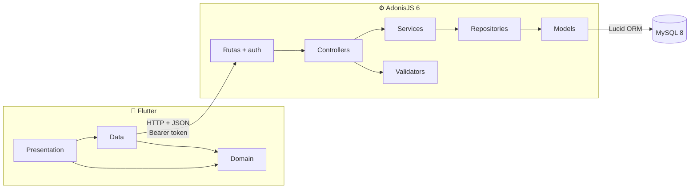

# Reporte técnico: ZIP Game

> **BORRADOR.** El contenido técnico ya describe el código real del repositorio. Lo marcado con
> **`[EQUIPO: completar]`** depende de ustedes: nombres, decisiones que tomaron, problemas que vivieron
> y conclusiones personales. El profesor pide que el reporte **explique las decisiones del equipo** y
> que no sólo pegue código, así que redacten esas partes con sus palabras.

---

## 1. Portada

| | |
|---|---|
| **Universidad** | Universidad Tecnológica de Durango (UTD) |
| **Materia** | Desarrollo para Dispositivos Inteligentes |
| **Práctica** | Práctica I: ZIP Game (tercer parcial) |
| **Grupo** | 10°A BIS |
| **Profesor** | Ing. Luis Ángel Martínez Vargas |
| **Integrantes** | `[EQUIPO: completar nombres y matrículas]` |
| **Repositorio** | `[EQUIPO: URL de GitHub]` |
| **Fecha** | `[EQUIPO: fecha de entrega]` |

---

## 2. Introducción

ZIP Game es un juego de lógica sobre un tablero de 6 × 6. El jugador traza un único camino que empieza en el número 1, conecta los números en orden ascendente con movimientos horizontales o verticales, pasa una sola vez por cada una de las 36 celdas y termina en el número más alto.

En esta práctica se construyó una aplicación completa con tres capas independientes que se comunican por HTTP + JSON:

- una app en **Flutter**, que funciona en Chrome con mouse y en Android con pantalla táctil;
- una **API REST en AdonisJS 6**, que valida cada solución, calcula el puntaje y genera niveles;
- una base de datos **MySQL 8**, donde se guardan jugadores, niveles, partidas, movimientos y puntajes.

El principio central del diseño es que **el servidor no confía en el cliente**: Flutter da retroalimentación inmediata, pero el backend vuelve a validar el camino completo antes de otorgar puntos.

`[EQUIPO: completar con la motivación del equipo y el alcance que se propusieron]`

---

## 3. Objetivos

### 3.1 Objetivo general

Desarrollar una aplicación móvil y web del juego ZIP con arquitectura por capas, comunicación cliente-servidor por una API REST, persistencia en MySQL, validación de reglas en el servidor, autenticación y pruebas automáticas.

### 3.2 Objetivos específicos

1. Implementar en Flutter un tablero 6 × 6 interactivo (táctil y mouse) con retroalimentación inmediata, cronómetro, progreso, deshacer, reiniciar y pistas.
2. Separar el frontend en capas *presentation / domain / data* organizadas por funcionalidad (*feature-first*).
3. Construir una API REST con AdonisJS 6 organizada en controladores, validadores, servicios y repositorios.
4. Modelar la base de datos con migraciones, llaves foráneas y restricciones que mantengan la integridad (por ejemplo, un solo puntaje por partida).
5. Validar en el servidor todas las reglas del juego y calcular el puntaje ahí mismo.
6. Generar automáticamente tableros que siempre tengan solución, con al menos tres dificultades medibles.
7. Ofrecer pistas inteligentes y dificultad adaptativa.
8. Probar el sistema con pruebas unitarias, funcionales, de widgets y de integración.

---

## 4. Descripción de ZIP Game

### 4.1 Reglas

| # | Regla | Dónde se valida |
|:---:|---|---|
| 1 | Empieza en el número 1 | `ZipRules` (Flutter) y `GameValidatorService` (servidor): `INVALID_START` |
| 2 | Conecta los números en orden ascendente | `CHECKPOINT_ORDER` |
| 3 | Sólo movimientos horizontales o verticales | `NOT_ADJACENT` |
| 4 | No repite celdas | `REPEATED_CELL` |
| 5 | Pasa por las 36 celdas | `INCOMPLETE` |
| 6 | Termina en el número más alto, y no se puede llegar a él antes | `PREMATURE_END` / `INVALID_END` |

### 4.2 Flujo de uso

1. El jugador se registra o inicia sesión y obtiene un token *Bearer*.
2. En **Niveles** ve la lista que viene del servidor, con su dificultad y si ya la completó. Puede filtrar por dificultad o **generar** un nivel nuevo.
3. Al abrir un nivel, la app hace `POST /api/games`. El servidor crea la sesión con **su propia hora de inicio** y devuelve el tablero **sin la solución**.
4. El jugador dibuja el camino tocando o arrastrando. Puede deshacer, reiniciar y pedir pistas al servidor.
5. Al cubrir las 36 celdas, la app envía el camino y el registro de movimientos (`POST /api/games/:id/finish`). El servidor valida, calcula el puntaje en una transacción, ajusta la dificultad recomendada y responde con el resumen.
6. **Ranking** y **Mi perfil** muestran la información guardada en MySQL.

`[EQUIPO: insertar capturas de cada pantalla (login, niveles, juego, resumen, ranking, perfil)]`

---

## 5. Tecnologías seleccionadas

| Tecnología | Versión | Uso | Por qué |
|---|---|---|---|
| Flutter / Dart | 3.50 / 3.14 | App móvil y web | Un solo código para Android y Chrome. Widgets propios para dibujar el tablero y responder a gestos |
| `material_ui` | 1.11 | Componentes Material 3 | En Flutter 3.50, Material se distribuye como paquete y `package:flutter/material.dart` está marcado como obsoleto |
| `http` | 1.6 | Cliente HTTP | Ligero, y en las pruebas se puede sustituir por un `MockClient` |
| `shared_preferences` | 2.5 | Guardar el token | Persistencia simple en web y Android |
| AdonisJS | 6.18 | API REST | Framework MVC completo en TypeScript con inyección de dependencias, ORM, validación, autenticación y pruebas integradas |
| VineJS | 3 | Validación | Esquemas declarativos. Responde `422` con el detalle de cada campo |
| Lucid ORM | 21 | Acceso a datos | Modelos, relaciones, migraciones, seeders y transacciones |
| MySQL | 8.0 | Base de datos | Relacional, con transacciones InnoDB, columnas JSON y llaves foráneas |
| Japa | 4 | Pruebas del backend | Runner oficial de AdonisJS, con cliente HTTP para pruebas funcionales |
| flutter_test | SDK | Pruebas del frontend | Pruebas unitarias y de widgets |

`[EQUIPO: completar si evaluaron otras alternativas y por qué las descartaron]`

---

## 6. Arquitectura del software



- **Cliente delgado en reglas críticas:** Flutter conoce las reglas (`ZipRules`) sólo para dar retroalimentación inmediata. La validación que da puntos es la del servidor.
- **Contratos JSON explícitos:** los *presenters* del backend (`app/utils/presenters.ts`) definen exactamente qué campos salen, y los modelos de Flutter (`data/models`) los convierten en entidades de dominio.
- **Inyección de dependencias:** en el backend con `@inject()` del contenedor de AdonisJS, y en Flutter con `AppScope` (un `InheritedWidget`) que construye los repositorios una sola vez. Gracias a esto, en las pruebas se usan repositorios falsos (`test/helpers/fakes.dart`).

---

## 7. Frontend: organización y componentes

```text
lib/
├── app/          app.dart (MaterialApp + sesión) · app_scope.dart (dependencias) · routes/ · theme/
├── core/         constants/api_constants.dart · errors/api_exception.dart · network/api_client.dart, token_storage.dart · utils/formatters.dart
├── features/
│   ├── auth/         login, registro y AuthController
│   ├── home/         inicio con datos del jugador y navegación
│   ├── levels/       lista con filtros, estados cargando/vacío/error, generar nivel
│   ├── game/         ZipRules · GameController · ZipBoard · GameHud · ResultSummary
│   ├── leaderboard/  ranking
│   └── profile/      estadísticas, niveles completados e historial
└── shared/widgets/async_view.dart
```

| Componente | Responsabilidad |
|---|---|
| `ZipRules` (domain) | Reglas puras del juego: movimiento válido, siguiente número, tablero completo. No depende de Flutter |
| `GameController` (`ChangeNotifier`) | Estado de la partida: camino, movimientos registrados, errores, pistas, cronómetro, progreso y estado (`loading`, `playing`, `submitting`, `completed`, `error`). La página no contiene lógica del juego |
| `ZipBoard` | Dibuja la cuadrícula, los números y la línea del camino. Convierte toques y arrastres (mouse o táctil) en índices de celda. Marca en rojo el movimiento inválido y resalta la celda de la pista |
| `GameHud` | Cronómetro, progreso `n/36`, siguiente número, errores y botones de deshacer, reiniciar y pista |
| `ResultSummary` | Resumen que llega del servidor: puntaje, desglose y recomendación de dificultad |
| `ApiClient` | Agrega el token, aplica un tiempo límite y convierte las respuestas de error en `ApiException` con mensajes legibles |
| `AsyncView` | Patrón común para los estados cargando, vacío y error |

**Gestos y teclado:** un toque agrega una celda. Arrastrar va extendiendo el camino, y arrastrar de regreso a la celda anterior la deshace. Con teclado, las flechas o WASD avanzan desde la última celda (`GameController.moveBy`), volver hacia la celda anterior deshace, y Retroceso o Z deshacen. La tecla se captura con `HardwareKeyboard` sólo mientras la pantalla de juego está visible, y no desplaza la página. Cada interacción se registra como `MoveRecord` (`add`, `undo`, `invalid`, `restart`) y se envía al terminar.

**Diseño adaptable:** `GamePage` decide con `LayoutBuilder`. En pantallas horizontales (PC) el tablero ocupa todo el alto disponible y el panel (datos, mensajes, botones, ayuda de teclado y resultado) va a la derecha; en celular todo va en columna. Los colores vienen del `ColorScheme`, así la app se ve correcta en tema claro y oscuro.

`[EQUIPO: explicar por qué eligieron ChangeNotifier + InheritedWidget en vez de Provider, Riverpod o BLoC]`

---

## 8. Backend: organización y servicios

| Capa | Archivos | Responsabilidad |
|---|---|---|
| Controllers | `auth`, `users`, `levels`, `games`, `leaderboard` | Reciben la petición, validan con VineJS, delegan y responden. Sin lógica de negocio |
| Validators | `auth_validator`, `game_validator` | Formato de las peticiones: rangos de celdas `0..35`, longitudes, enums, unicidad de email y usuario |
| Services | `game_validator_service` | Reglas del juego (prefijo y solución completa) |
| | `path_solver_service` | Backtracking/DFS con heurística de Warnsdorff y poda por conectividad. Cuenta soluciones y mide el esfuerzo de búsqueda |
| | `level_generator_service` | Caminos hamiltonianos con *backbite*, colocación de números y medición de dificultad |
| | `hint_service` | Pista de la siguiente celda o de cuántos pasos retroceder |
| | `scoring_service` | Cálculo del puntaje |
| | `adaptive_difficulty_service` | Calificación de partidas y recomendación de dificultad |
| | `game_service` | Orquesta iniciar, dar pista y terminar (con transacción) |
| | `leaderboard_service` | Ranking |
| Repositories | `user`, `level`, `game_session`, `score` | Todas las consultas a la base de datos |
| Models | `User`, `Level`, `GameSession`, `GameMove`, `Score` | Mapeo con Lucid, relaciones y columnas JSON |
| Exceptions | `GameException`, `handler` | Errores de dominio con `{ message, code, details }`. Sin *stack traces* en producción |

`[EQUIPO: completar con la razón de separar servicios y repositorios]`

---

## 9. Diseño de la base de datos

El diagrama entidad-relación completo y la descripción de cada columna están en el [README](../README.md#-base-de-datos-diagrama-entidad-relación).

| Tabla | Propósito | Claves e índices relevantes |
|---|---|---|
| `users` | Jugadores. Contraseña con hash y dificultad recomendada | `username` UNIQUE, `email` UNIQUE |
| `auth_access_tokens` | Tokens *Bearer* (sólo su hash) | FK `tokenable_id` → `users` (CASCADE) |
| `levels` | Tablero: `checkpoints` (JSON), `solution` (JSON, oculta), métricas de dificultad | índice en `difficulty` |
| `game_sessions` | Partidas: estado, hora de inicio y fin del servidor, errores, pistas, camino final | FK a `users` y `levels`, índice (`user_id`, `status`) |
| `game_moves` | Cada interacción del jugador | FK a `game_sessions`, UNIQUE (`game_session_id`, `sequence`) |
| `scores` | Puntajes validados | **UNIQUE `game_session_id`**, índices (`user_id`, `level_id`) y `points` |

**Decisiones:**
- Las celdas se numeran `0..35` y los números del tablero se guardan como una lista JSON (`checkpoints[i]` = celda del número `i+1`). Así el tablero queda en una sola columna y es fácil de enviar.
- La dificultad se **copia** en la sesión al iniciar, para que la adaptación no altere una partida en curso.
- Para evitar el doble puntaje se combinan tres cosas: un bloqueo de la fila de la sesión con `FOR UPDATE`, la revisión `status = in_progress` (si ya terminó responde `409`) y el `UNIQUE` en `scores.game_session_id`.
- Todo se crea con **migraciones** y los datos de demostración con **seeders** de semilla fija, para que todos los integrantes obtengan los mismos tableros.

---

## 10. Implementación de la API REST

La tabla completa de endpoints, con métodos, cuerpos, respuestas y códigos de estado, está en el [README](../README.md#-endpoints-rest).

- **Públicas:** `POST /auth/register`, `POST /auth/login`, `GET /leaderboard`.
- **Protegidas (Bearer):** `/users/me`, `/levels`, `/levels/:id`, `/levels/generate`, `/games`, `/games/:id`, `/games/:id/hint`, `/games/:id/finish`, `/games/history`, `/auth/logout`.
- **Códigos:** `201` al crear, `400` por credenciales inválidas, `401` sin token, `404` cuando el recurso no existe o es de otro usuario (para no revelar que existe), `409` si la partida ya terminó y `422` por validación o solución inválida.

`[EQUIPO: agregar capturas de Chrome DevTools → Network con login, levels, games y finish]`

---

## 11. Algoritmos del juego y validación

### 11.1 Validación del camino (`GameValidatorService`)

Recorre el arreglo `path` una sola vez (O(n)):
1. Comprueba que cada celda esté dentro de `0..35` y que el camino inicie en la celda del número 1.
2. Para cada paso revisa la **adyacencia**: `|Δfila| + |Δcolumna| = 1`.
3. Lleva un conjunto de celdas visitadas para detectar repetidas.
4. Mantiene `nextCheckpoint`: si la celda tiene número, debe ser exactamente el siguiente esperado.
5. El último número sólo es válido como la celda 36.
6. Para la solución completa exige longitud 36 y que termine en el último número.

Cada error devuelve un código, un mensaje y el **índice** donde ocurrió. Flutter aplica las mismas reglas (`ZipRules`) para pintar el error al instante.

### 11.2 Solucionador (`PathSolverService`)

Es una búsqueda en profundidad con *backtracking*. Para podar se usan:
- la **heurística de Warnsdorff**: probar primero el vecino con menos salidas libres;
- la **poda por conectividad**: si las celdas libres quedan divididas en partes desconectadas, ese camino no puede terminar;
- los **callejones**: una celda libre con un solo vecino disponible tendría que ser el final del camino, así que si no es el último número ese estado se descarta;
- el **orden de números**: no se puede pisar un número fuera de turno, y el último sólo se pisa como celda 36.

Se usa para verificar que un nivel tenga solución, contar soluciones (hasta 50), medir el esfuerzo de búsqueda y dar pistas cuando el jugador se aleja de la solución guardada.

### 11.3 Pistas inteligentes (`HintService`)

1. Valida el prefijo enviado. Si es inválido responde `422` con el motivo.
2. Si el prefijo coincide con la solución guardada, la pista es la siguiente celda de esa solución.
3. Si no coincide, busca una continuación válida desde el camino actual.
4. Si no hay salida, retrocede paso a paso hasta encontrar un prefijo con solución y responde `backtrack` con cuántos pasos deshacer y qué celda tomar.

Nunca se envía la solución completa. Cada pista se cuenta en la sesión y resta 150 puntos.

`[EQUIPO: explicar con un ejemplo propio cómo funciona el backtracking]`

---

## 12. Generación de niveles y dificultad

### 12.1 Generación con solución garantizada

1. Se parte de un recorrido en serpiente, que es un camino hamiltoniano válido.
2. Se aplican miles de **movimientos *backbite*** aleatorios: se toma un extremo del camino, se conecta con un vecino que ya está en el camino y se invierte el tramo correspondiente. Cada movimiento produce otro camino hamiltoniano, así que el resultado **siempre** es válido y muy variado.
3. Se colocan los números sobre ese camino (el 1 al inicio y el mayor al final), espaciados según la dificultad.
4. Se verifica con `GameValidatorService` y `PathSolverService` antes de guardar en MySQL.

Como el camino mismo cumple todas las reglas, **el nivel siempre tiene al menos una solución**.

### 12.2 Medición de la dificultad

La etiqueta no es aleatoria: se calcula un **puntaje de dificultad de 0 a 100** con métricas objetivas.

| Métrica | Peso máximo | Idea |
|---|:---:|---|
| Separación promedio entre números | 35 | Menos números significa menos guía |
| Número de soluciones distintas (tope 50) | 25 | Más soluciones obligan a tomar más decisiones |
| Esfuerzo de búsqueda sin heurística (nodos) | 25 | Qué tan difícil es para un algoritmo "ingenuo" |
| Giros del camino de la solución | 15 | Un camino más sinuoso es menos intuitivo |

| Dificultad | Números | Banda de puntaje |
|---|:---:|:---:|
| Fácil | 10–13 | < 45 |
| Media | 7–9 | 45–67 |
| Difícil | 4–6 | ≥ 68 |

Las bandas se calibraron generando 180 tableros (60 por categoría): la mediana fue 41 en fácil, 61 en media y 77 en difícil. El generador repite (hasta 40 intentos) hasta que el puntaje cae en la banda pedida. Una prueba unitaria verifica que, en promedio, los niveles difíciles tienen un puntaje mayor que los fáciles.

### 12.3 Dificultad adaptativa

Cada partida terminada se califica como **excelente** (tiempo ≤ objetivo, 0 pistas y ≤ 2 errores), **deficiente** (tiempo > 2× objetivo, ≥ 3 pistas o ≥ 10 errores) o **normal**. Con las **últimas 3 partidas** en la dificultad actual: con 2 o más excelentes **sube**, con 2 o más deficientes **baja**, y en otro caso **se mantiene**. La recomendación se guarda en `users.recommended_difficulty` y sólo afecta a las partidas siguientes. Si se inicia una partida sin indicar nivel, el servidor elige uno pendiente de la dificultad recomendada.

---

## 13. Autenticación y seguridad

| Medida | Implementación |
|---|---|
| Hash de contraseñas | `scrypt` (cost 16384) mediante `withAuthFinder`. El hash nunca se serializa |
| Tokens | Tokens opacos `zip_…` con vigencia de 7 días. En la tabla sólo se guarda su hash. Middleware `auth` en las rutas protegidas |
| Autorización | Las consultas de sesiones filtran por `user_id`, así que una partida ajena responde `404` |
| Validación | VineJS en todas las peticiones: rangos de celdas, longitudes, enums, unicidad |
| Puntaje en el servidor | El cliente nunca envía puntos. El tiempo se calcula con la hora del servidor |
| Doble finalización | Transacción + `FOR UPDATE` + revisión de estado (`409`) + `UNIQUE` en `scores` |
| Secretos | `.env` y `.env.test` en `.gitignore`. `.env.example` sin contraseñas |
| Errores | En producción, `500` genérico sin *stack trace* ni SQL. Los `404` de Lucid se traducen a `{ message, code }` |
| CORS | En desarrollo se permite `localhost` con cualquier puerto. En producción sólo los orígenes de `CORS_ORIGINS` |

---

## 14. Metodología y resultados de pruebas

| Suite | Herramienta | Pruebas | Resultado | Evidencia |
|---|---|:---:|---|---|
| Backend, unitarias | Japa | 25: validador (9), generador (6, una por dificultad en la prueba con *dataset*), puntaje (3), pistas (3), adaptativo (4) | ✅ aprobadas | [`evidencias_backend.txt`](evidencias/evidencias_backend.txt) |
| Backend, funcionales | Japa + api-client, sobre `zip_game_test` | 12 (registro, login, rutas protegidas, niveles sin solución, generar, flujo completo, solución inválida, doble finalización, partida ajena, historial y ranking) | ✅ aprobadas | [`evidencias_backend.txt`](evidencias/evidencias_backend.txt) |
| Flutter, dominio | flutter_test | 8 (`ZipRules`) | ✅ aprobadas | [`evidencias_flutter.txt`](evidencias/evidencias_flutter.txt) |
| Flutter, controlador | flutter_test + repositorio falso | 13 (`GameController`: 8 de clic/arrastre/pistas/fin + 5 de movimiento con teclado) | ✅ aprobadas | [`evidencias_flutter.txt`](evidencias/evidencias_flutter.txt) |
| Flutter, widgets | `testWidgets` | 4 (render del tablero, retroalimentación, flechas/WASD/Retroceso, resumen) | ✅ aprobadas | [`evidencias_flutter.txt`](evidencias/evidencias_flutter.txt) |
| Integración | flutter_test contra el backend real | 1 (registro → nivel → partida → 36 pistas → finish → puntaje) | ✅ aprobada | [`evidencias_integracion.txt`](evidencias/evidencias_integracion.txt) |

**Resultados:** backend **37/37** aprobadas · Flutter **25/25** aprobadas · integración **1/1** aprobada (se ejecuta aparte con `--dart-define=INTEGRATION=true` y el backend encendido).

Después de la prueba de integración se revisó MySQL: el usuario nuevo tiene la contraseña guardada como hash `$scrypt$n=16384,...`, la partida quedó en `completed`, se guardaron sus 36 movimientos en `game_moves` y un único registro en `scores` (100 puntos: el mínimo del 10 %, porque se usaron 36 pistas).

**Pruebas manuales:** lista de la sección 19 de la práctica (registro, contraseña con hash en `users`, filtros, movimiento diagonal en rojo, deshacer, reiniciar, pista, completar, revisión de tablas, generar nivel, ranking y perfil).

`[EQUIPO: describir qué errores encontraron durante las pruebas y cómo los corrigieron]`

---

## 15. Retos técnicos y soluciones

| Reto | Solución aplicada |
|---|---|
| `npm init adonisjs@latest` crea AdonisJS 7 | Se usó `npm init adonisjs@2` para obtener AdonisJS 6 |
| Flutter Web corre en un puerto aleatorio y Chrome bloqueaba las peticiones (CORS) | `config/cors.ts` permite `localhost` con cualquier puerto en desarrollo |
| Generar tableros con solución garantizada | Partir de un camino hamiltoniano (*backbite*) en lugar de colocar números al azar y buscar después |
| Medir la dificultad sin etiquetarla al azar | Puntaje compuesto con 4 métricas y bandas calibradas con 180 tableros |
| Evitar que una partida genere dos puntajes | Transacción + `FOR UPDATE` + `UNIQUE` |
| Flutter 3.50 marca `package:flutter/material.dart` como obsoleto | Se usó el paquete `material_ui` |
| Ya había un MySQL/MariaDB de XAMPP en el puerto 3306 | MySQL Server 8.0 se instaló en el puerto 3307 y se configuró `DB_PORT` en `.env` |
| MySQL Shell se confundió con el servidor | MySQL Shell y Workbench son sólo clientes. Hubo que instalar **MySQL Server 8.0** desde MySQL Installer |
| La contraseña de `root` era rechazada (`ERROR 1045`) aunque era la del instalador | Se restableció con el método oficial `--init-file` (detener el servicio, arrancar `mysqld` con un archivo que ejecuta `ALTER USER` y volver a iniciar el servicio). Lección: usar contraseñas sin ñ, acentos ni símbolos, porque la consola de Windows los codifica distinto que el instalador |
| En la evidencia, una prueba aparecía como "generated **undefined** levels" | En Japa, los *datasets* de valores simples se interpolan con `{$self}`, no con `{difficulty}`. Se corrigió el título en `tests/unit/level_generator.spec.ts` |
| La primera ejecución de `flutter create` tardó varios minutos | Es normal: la primera vez Flutter descarga los artefactos de web/Android y los paquetes de pub.dev |
| En modo oscuro varios elementos casi no se veían: números negros sobre celdas gris oscuro, texto blanco sobre lavanda claro o sobre círculos pastel, y la tarjeta de resultado con fondo verde casi blanco y texto claro | Los colores fijos (`Colors.black87`, `Colors.white`, `green.shade50`) se cambiaron por colores del `ColorScheme` (`inverseSurface/onInverseSurface`, `primary/onPrimary`, mezclas con `surface`), que se adaptan al tema claro y al oscuro |
| En una pantalla de 1366×768 el tablero no cabía y los botones quedaban fuera de la vista | `GamePage` usa `LayoutBuilder`: en pantallas horizontales el tablero va a la izquierda con todo el alto disponible y el panel a la derecha; en celular se usa una columna con el tablero ajustado al alto |
| La barra de datos (`Wrap` de *chips*) saltaba de renglón cuando cambiaba un número (9/36 → 10/36) y movía el tablero mientras se jugaba | Distribución fija (5 en una fila, o 3 + 2) con `Expanded`, `FittedBox` y dígitos de ancho fijo (`tabularFigures`) |
| Jugar sólo con clic era lento en PC | Movimiento con teclado (flechas o WASD; Retroceso o Z para deshacer). La página sólo traduce la tecla a `GameController.moveBy(fila, columna)`, que aplica las mismas reglas que un clic. Para no perder la vista, la celda actual se marca con un borde y el siguiente número con un anillo. Cubierto con 5 pruebas del controlador y 1 de widget |
| `[EQUIPO: otros retos]` | `[EQUIPO]` |

---

## 16. Conclusiones

`[EQUIPO: completar. Sugerencias: qué aprendieron de separar frontend, backend y BD; por qué validar en el servidor; qué mejorarían (más tamaños de tablero, modo sin conexión, despliegue en la nube); la conclusión individual de cada integrante]`

---

## 17. Referencias

- AdonisJS 6: documentación oficial. https://docs.adonisjs.com
- Lucid ORM. https://lucid.adonisjs.com
- VineJS. https://vinejs.dev
- Japa. https://japa.dev
- Flutter: documentación oficial. https://docs.flutter.dev
- Paquete `material_ui`. https://pub.dev/packages/material_ui
- MySQL 8.0 Reference Manual. https://dev.mysql.com/doc/refman/8.0/en/
- Camino hamiltoniano. https://es.wikipedia.org/wiki/Camino_hamiltoniano
- Regla de Warnsdorff (recorrido del caballo). https://en.wikipedia.org/wiki/Knight%27s_tour#Warnsdorf's_rule
- Algoritmo *backbite* para muestrear caminos hamiltonianos: Mansfield, M. L. (1982). *Monte Carlo studies of polymer chain dimensions in the melt*. Journal of Chemical Physics.
- `[EQUIPO: agregar las fuentes que consultaron]`

---

## 18. Anexos

- **A.** Diagrama entidad-relación y arquitectura, en el [README](../README.md).
- **B.** Documentación de endpoints, en el [README](../README.md#-endpoints-rest).
- **C.** Evidencias de pruebas, en [`docs/evidencias/`](evidencias/).
- **D.** Capturas de pantalla de la app: `[EQUIPO: agregar en docs/capturas/]`.
- **E.** Capturas de Chrome DevTools → Network: `[EQUIPO: agregar]`.
- **F.** Fragmentos de código relevantes: `game_validator_service.ts`, `level_generator_service.ts`, `hint_service.ts`, `game_controller.dart`, `zip_board.dart`.
